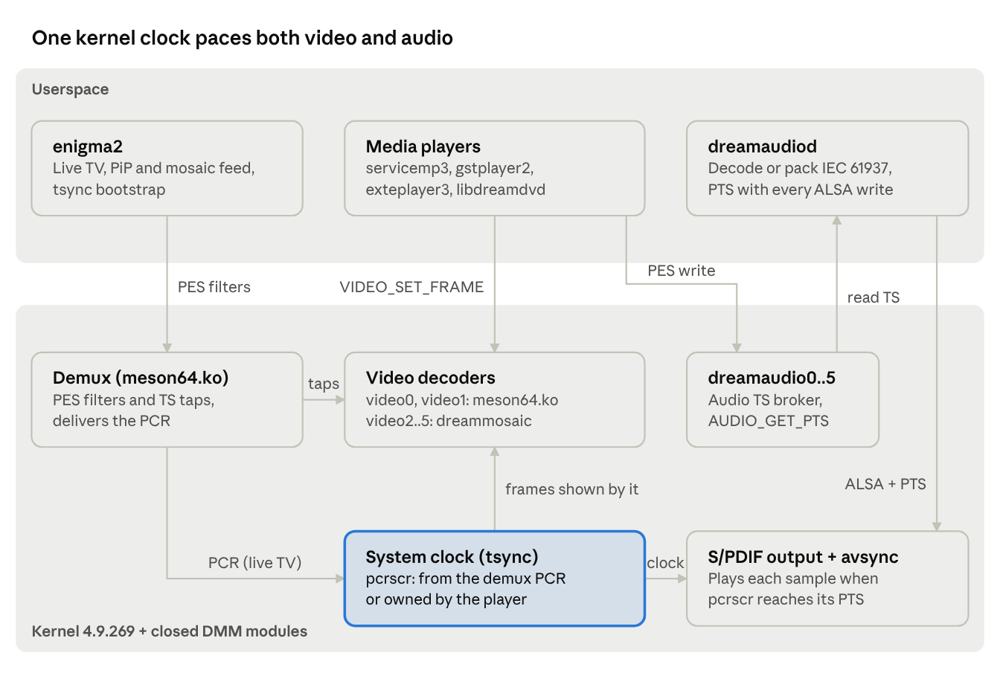

# DreamNextGen A/V Architecture

Oct 23, 2026 · WXbet

On the Dreambox DreamOne and DreamTwo (Amlogic S922X) the closed DMM driver decodes video, while all audio is decoded in userspace by the dreamaudiod service; the kernel keeps audio and video in sync by pacing the audio output against the same system clock the video layer presents frames by. This document explains how kernel, audio service, video decoders, enigma2 and the media players fit together, so the next developer does not have to rediscover it.

## At a glance



enigma2 and the players feed the video decoders and write audio into the dreamaudio broker; dreamaudiod decodes it and hands every block to the S/PDIF driver with its PTS. The video layer and the S/PDIF output both run by the same tsync system clock, which follows the demux PCR for live TV and the player for media playback.

## Hardware and software stack

Both boxes use the Amlogic S922X (G12B). The DreamTwo device tree is the DreamOne tree plus an LCD panel include, so every DreamOne device-tree change applies to both. The SoC has hardware video decoders but no audio decoder the stack can use, which is the root of the whole audio design.

| Layer | What it is | Open or closed |
| --- | --- | --- |
| Kernel 4.9.269 | Rebuilt from CoreELEC `amlogic-4.9-20` (merge `285e9faf2f`, Amlogic sync 20210524, the same point DMM used) plus our own changes; repo `linux-dreambox-meson64`, branch `4.9.269` | Open |
| DMM driver release 20230404 | `meson64.ko` (demux, DVB video devices `video0..1`, `VIDEO_*` ioctls, `/proc/stb/*`), `stream_input.ko`, the Amlogic decoder modules (`amvdec_*`), `decoder_common`, `media_clock` | Closed, binary only; fixed by binary patches in the recipe |
| dreammosaic | Out-of-tree kernel module: video decoders `video2..5` and a ge2d compositor for QuadPiP | Open (in the build layer) |
| dreamaudiod | Userspace audio decoding service | Open (in the build layer) |
| enigma2 | Live TV, PiP/mosaic feeding, servicemp3 | Open |
| Players | dvbmediasink (dvbvideosink, dvbaudiosink), gstplayer2, exteplayer3, libdreamdvd, ServiceApp | Open |

The kernel reports its release as `4.9` (so modules load from `/lib/modules/4.9`) while `SUBLEVEL` stays 269. All 45 DMM modules load with no missing symbols and no CRC mismatches, which is the proof that the rebuilt kernel's ABI matches DMM's. The DMM modules only work with this kernel.

The Dream-specific GStreamer sinks (`gstreamer1.0-dreamsinks`, `gst-plugin-dreamaudiosink`) are no longer used. Video and audio go through the standard dvbmediasink with a Dream backend. Do not install the dreamsinks on a test box: they hide gaps in our path.

## Audio path: demux hook, dreamaudio device, service

Audio for live TV and for every player goes into one kernel broker device, `dreamaudio`, and out of it to the dreamaudiod service. Players and enigma2 drive it with the plain DVB audio API, so nothing above the kernel knows the audio is decoded in userspace.

### Demux to service: the dmxdev audio sink

`drivers/media/dvb-core/dmxdev.c` with `include/media/dmxdev_audio.h` adds a hook, `struct dmxdev_audio_sink { start, write, stop, priv }`, registered once by the dreamaudio driver.

- A PES filter with `output = DMX_OUT_DECODER` and `pes_type = DMX_PES_AUDIO0..3` is set up as a TS tap (`TS_PACKET | TS_DEMUX`) when a sink is registered. The packets are descrambled exactly as a hardware decoder's would be.
- `dvb_dmxdev_ts_callback()` passes the TS packets to `sink->write()`; `start`/`stop` follow the filter.
- Without this hook `meson64.ko` rejects the audio decoder start with `EINVAL`, because DMM's `audio0` is only a stub.

### The dreamaudio device

Code: `sound/soc/amlogic/auge/dreamaudio.c`, UAPI `include/uapi/linux/dvb/dreamaudio.h`.

| Node | Meaning |
| --- | --- |
| `/dev/dvb/adapter0/dreamaudio0` | Main audio decoder (`DMX_PES_AUDIO0`), 2 MiB kfifo |
| `/dev/dvb/adapter0/dreamaudio1` | Second decoder (`DMX_PES_AUDIO1`); no service runs on it today, so PiP has no audio |
| `/dev/dvb/adapter0/dreamaudio2..5` | Aliases of device 0 for the mosaic decoders `video2..5`; only the focused mosaic window plays audio |

The same node has two roles:

- **Service** (dreamaudiod): claims the device with `DREAMAUDIO_SERVICE` (one per device, else `EBUSY`), `read()`s whole 188-byte TS packets, `poll()`s for `POLLIN` (data) and `POLLPRI` (state change), and fetches `DREAMAUDIO_GET_STATE`: `seq`, `clear_seq`, `play_state`, `source`, `bypass`, `channel`, `mute`, `av_sync`, `overflows`. The first claim also creates `/proc/stb/audio/audio_delay_pcm` and `audio_delay_bitstream` (hex, 90 kHz, positive = audio later).
- **Player** (enigma2, dvbaudiosink, exteplayer3, libdreamdvd): uses `AUDIO_PLAY/STOP/PAUSE/CONTINUE`, `AUDIO_SELECT_SOURCE`, `AUDIO_SET_AV_SYNC`, `AUDIO_SET_BYPASS_MODE` (the codec hint, handed to the service as `bypass`), `AUDIO_CHANNEL_SELECT`, `AUDIO_SET_MUTE`, `AUDIO_CLEAR_BUFFER` (bumps `clear_seq`). Each change bumps `seq`.
- **`AUDIO_GET_PTS`** returns the 33-bit PTS of the sample the output plays now (`map_pts + (hw_ptr - map_frame) * 90000 / rate`), or `ENODATA` before the output has a mapping. This is the ground truth for A/V measurements.

### Two sources

- **Demux** (`AUDIO_SOURCE_DEMUX`, live TV): TS from the hook. With `av_sync` on, `dreamaudio_skip_stale()` drops whole PES that are more than 200 ms behind the system clock (push-ahead of a recording after a jump).
- **Memory** (`AUDIO_SOURCE_MEMORY`, players): the player `write()`s PES. The kernel wraps it into synthetic TS packets (PID 1, own continuity counter), so the service always parses one format. A full fifo blocks the writer or returns `EAGAIN`.
- **Player lead limit**: `dreamaudio_ahead()` holds a player while its newest PES is more than 2 s (`PLAYER_LEAD`) ahead of what plays; a gap of 10 s (`PLAYER_JUMP`) counts as a jump. Without it a low-bitrate stream would buffer a minute that a flush throws away.
- `AUDIO_PAUSE`/`AUDIO_CONTINUE` on the memory source also hold the system clock (`aml_avsync_hold_clock()` → `tsync_pcr_hold()`), because the closed video decoder freezes on pause without telling tsync.
- `AUDIO_SET_AV_SYNC` must be 1 for synced playback. With 0 the service plays "as it comes" (free play, used for DAB+).

## Audio output: S/PDIF paced by the system clock

The kernel, not the service, decides when each sample sounds. The service tells the ALSA S/PDIF driver the PTS of every block it writes, and the driver plays each sample when the system clock (`pts_pcrscr`) reaches that PTS. Since the video layer presents frames by the same clock, A/V sync holds whatever latency the decoding service has.

Code: `avsync.[ch]` and the `.copy` op in the S/PDIF driver under `sound/soc/amlogic/auge/`. `spdif_b` feeds HDMI, `spdif_a` feeds optical.

### ALSA controls

| Control | Meaning |
| --- | --- |
| `Audio Sync PTS` | INTEGER64: PTS of the first frame of the next `writei`, or -1. Set before every write. |
| `Audio Sync Offset` | User offset in ms, -1000..1000 |
| `Audio Sync Clock` | 0 = the system clock follows the demux PCR (live); 1 = a player owns it. Reset to 0 in `hw_free`. |
| `Audio Sync Status` | Read-only: error µs, trim ppm, frame shift, drops, restarts, state bits (gating 1, started 2, mapped 4), inserts |

The `spdif_a` (optical) controls carry the prefix ` SPDIF  `.

### How the pacing works

1. **Mapping.** `avsync_update()` maps the ALSA application pointer to `map_pts`. Writes that repeat one PES's PTS keep the old mapping.
2. **Start gate.** At trigger start the output stays muted. An hrtimer starts the FRDDR exactly when the first frame is due (plus a 3 ms lead), waiting at most 4 s (`GATE_EARLY_US`); with no usable clock it gives up after 1 s (`GATE_MAX_MS`). While gating, `pointer()` reports 0.
3. **Steady state.** `err = queued play time - due time`.
   - More than 20 ms late: drop frames, at most a quarter of the buffer, rounded to the quantum.
   - More than 20 ms early: insert silence; with no room for it and more than 40 ms early, stop with an xrun (2 s holdoff).
   - A correction needs the error to persist until the next distinct PTS.
   - Small errors go to a PI clock trim every 500 ms (KP 50, KI 5, max ±500 ppm) that retunes the S/PDIF clocks.
4. **Bookkeeping.** Drops and inserts accumulate in `shift`; `pointer()` reports `phys + ptr_shift`, so ALSA's buffer accounting stays right. Without this the buffer shrank with every drop.
5. **Bitstream.** The quantum is one whole IEC 61937 burst, learned from the frame distance of two mapped writes (AC-3 1536, AC-4 1920, DTS 1024 or 2048). E-AC-3 (4x clock) and HBR (8 channels at 4x) scale the rate.

### Limits and offsets

- `TIMING_LIMIT_US` = 2 s: a due time outside ±2 s is ignored and the output plays free.
- In player mode on a running output, late data up to 10 s (`PLAYER_LATE_LIMIT_US`) is dropped instead. This covers an HLS audio rendition that restarts seconds late after an inserted ad.
- The target is `pcrscr - 8 ms` (module parameter `avsync_offset_ms`, default -8), minus the user offset, plus `/proc/stb/audio/audio_delay_pcm` or `audio_delay_bitstream`.
- Clock source (`avsync_scr()`): in player mode the timestamp clock while it is enabled (stopped clock = free play); in live mode only in PCR-master mode with a valid demux PCR (a PCR flagged invalid is accepted while within 1 s of `pcrscr`, which covers recordings after pause or jump).
- Debug: module parameter `avsync_debug` (1 logs the trim, 2 logs every write).

### S/PDIF plumbing

- Mute sits in the controller (`SPDIFOUT_CTRL0` bits 21-22), so it survives stream restarts. Controls: `Audio spdif mute`, `Audio spdif_b mute`.
- `spdif_b` is the hdmitx audio source from probe on.
- Boot silence: the device-tree property `amlogic,boot-silence` clocks the optical output with zeros from probe on, so the receiver is locked before the first sound.

## Clocks: tsync, live TV and player mode

One system clock, `pcrscr`, drives both the video presentation and the audio output. It runs from the demux PCR for live TV and recordings, and is owned by userspace for media playback. Getting this clock right is most of A/V sync on this platform.

Code: `drivers/amlogic/media/frame_sync/` (`tsync.c`, `tsync_pcr.c`, `timestamp.c`) and the vsync path in `video.c`.

### Signals

| sysfs (`/sys/class/tsync/`) | Meaning |
| --- | --- |
| `mode`, `enable` | Live TV runs in pcrmaster (mode 2, enable 1): the clock follows the demux PCR. Mode 0 = system clock. Audio master is never used, because tsync never sees audio. |
| `pts_pcrscr` | The system clock the video layer presents by, `pcr_offset` already subtracted. Reads 0 for 1–1.5 s after a zap. Keeps running through a CW loss. |
| `pts_video` | PTS of the frame on screen. Use this, not `VIDEO_GET_PTS`, which returns cached values. Sticks during a CW loss. |
| `firstvpts` | PTS of the stream's first frame; reads 0 on zap and on CW recovery, then a new value. A reliable marker that the kernel accepted a discontinuity. |
| `demux_pcr` | Raw PCR from the demux |
| `pts_audio`, `firstapts` | Always unset. Never write `pts_audio`: tsync would then track two clocks and audio and video pull each other off (a 207 ms oscillation was observed). |

Also useful: `/sys/class/video/vframe_ready_cnt` (frames queued, 5–7 while healthy), `/proc/stb/pcr_offset` (video shown when `pts_video <= demux_pcr - pcr_offset`).

### Live TV (PCR master)

- enigma2 bootstraps tsync on every main-decoder start: stop PCR sync, `mode = 2`, `enable = 1`, `pcr_offset = 75 ms`, `TSYNC_IOC_SET_DEMUX_INFO` with the PIDs (details under enigma2).
- `tsync_pcr.c` sets `pcrscr` from the demux PCR; the S/PDIF pacing follows it.
- **Late PCR at boot:** if tsync starts before the demux reports a PCR, it runs on the system clock. `tsync_pcr_wait_demux` switches to the PCR after 50 consecutive valid checks (log: `demux PCR valid now`).
- **Played recordings:** after a video discontinuity tsync follows the demux PCR again when it is valid and close to the video PTS (before, it switched to the video clock for good and the audio stayed seconds behind). The PCR validity check compares against `firstvpts`, because after fast forward the decoder check-in runs far ahead.

### Player mode (system clock owned by userspace)

A media player has no usable demux PCR, so the service sets the ALSA control `Audio Sync Clock` = 1, which calls `tsync_pcr_set_sysclock(true)`:

- `tsync_disable_demux_pcr` is set; a clock running on the demux switches to free running from the current video PTS, and `tsync_set_pcr_mode` is refused.
- The clock restarts at play, after pause and on seek, following the video.
- **First picture rule:** at `VIDEO_START`, if a player owns the clock and it is more than 1 s away from the first picture's PTS, the clock restarts from that picture. Without it the service often switched the clock on before the first frame, the clock ran from a stale value and never reached the picture (black picture forever with sync mode "black").
- **Video underflow:** while the video output has no picture (a late HLS segment), the vsync takes back its increment of `pcrscr` (`tsync_pcr_player_clock()`), as in video master mode. Without it the clock ran on during the stall, audio and video then dropped different amounts of late data and the audio drifted ahead over the hours.
- **External owner:** `timestamp_pcrscr_external(true)` stops the vsync from advancing `pcrscr`. The mosaic sets the clock itself every output period; the extra vsync increments made the audio drop a period now and then.

### Sync mode (`/proc/stb/video/sync_mode`)

The proc file belongs to the closed `meson64.ko`; enigma2 shows it as "Sync mode" in the picture settings (default slow). It only switches `slowsync_repeat_enable`: slow = 1, hold and black = 0.

| Value | Until audio and video are in sync |
| --- | --- |
| `slow` (default) | Frames repeat until the picture catches up with the clock (slow motion) |
| `hold` | First frame shown and held |
| `black` | Nothing shown until `pts_pcrscr` reaches the frame's PTS (default on DreamOS) |

`black` is the strict case: any player-clock bug shows up as a permanent black picture, while `slow` hides it.

## dreamaudiod

dreamaudiod is the audio decoder of the box: it reads TS from `dreamaudio0`, decodes to PCM or packs IEC 61937 bitstream, and writes to ALSA with a PTS per block. There is no IPC with enigma2 or the players; both sides only talk to the kernel device.

Source: `meta-brands/meta-dream/recipes-bsp/dreamaudiod/dreamaudiod.cpp` (one file, C++17), recipe `dreamaudiod_1.0.bb`. It links FFmpeg (avformat, avcodec, swresample, avutil), FAAD2 and alsa-lib, and copies `dreamaudio.h` from the kernel it is built against. The machine include makes it mandatory in every image.

### Start and main loop

- `/etc/init.d/dreamaudiod` (rcS, `S40`) starts a respawn loop under `setsid` that restarts the binary 1 s after any exit. Without `setsid` the loop died with the boot scripts and the box had no sound.
- `main()` opens `/dev/dvb/adapter0/dreamaudio0` (default) and claims it with `DREAMAUDIO_SERVICE`.
- It polls with a 1 s timeout and reads small chunks (32 TS packets), so a pause stops the output within a fraction of a second. While paused it waits only for `POLLPRI`; the data stays in the kernel buffer.
- On a state change: `AUDIO_CLEAR_BUFFER` (changed `clear_seq`) resets the stream; STOPPED closes the PCM; PLAYING→PAUSED flushes; PAUSED→PLAYING resumes. It sets `Audio Sync Clock` for a memory source or the mosaic, and free play for a memory source with `av_sync` off.
- It reads enigma2's settings directly: `/etc/enigma2/settings` is re-parsed when its mtime changes (`config.av.transcodeac3plus`, `transcodeaac`, `dtshd`, `truehd`, `ac4`), plus `/sys/class/audiodsp/digital_raw` and the HDMI EDID caps under `/sys/class/amhdmitx/amhdmitx0/`.

### Stream processing

1. **TS and PES.** Continuity gaps drop the current PES. A PES whose payload does not start with `00 00 01` is ignored (hardware descrambling leaves the scrambling bits set).
2. **Codec detection.** A `BCMA` header means Broadcom-style PCM from a player (LPCM, played as is). Otherwise FFmpeg `av_probe_input_format3()` over at least 4 KB; MPEG audio is refined to MP1/MP2/MP3. When the player hints MPEG (bypass 1), two frame headers one frame apart start it at once. A codec that yields no frames for 2 s is re-probed.
3. **Mode per codec:**
   - **Passthrough** for AC-3, E-AC-3, DTS, TrueHD, AC-4 when `digital_raw` and the per-codec setting allow it and (on HDMI) the EDID lists the codec. Never on Bluetooth.
   - **HBR passthrough** (8 ch at 192 kHz) for TrueHD and DTS-HD when the EDID allows 192 kHz and the output takes eight channels. The S/PDIF outputs take two, so today DTS-HD falls back to passthrough of the DTS core (48 kHz) and TrueHD to decoding (log: `takes no 8 channels`, `stream dts, passthrough of the core`).
   - **Transcode to AC-3** (FFmpeg encoder, 448 kbit/s 5.1 or 192 kbit/s stereo) for AAC/LATM or E-AC-3 when set to "force AC-3".
   - **Decode** with FFmpeg to stereo S16 at 32, 44.1 or 48 kHz (other rates resampled to 48 kHz), with headroom for 5.1+ downmixes. Software volume from the ALSA softvol `Master`.
4. **DAB+ HE-AAC.** DAB+ uses 960-sample frames, for which FFmpeg has no SBR. For LATM with a 960 frame length dreamaudiod decodes with FAAD2; all other LATM goes to FFmpeg.
5. **AC-4 passthrough** is packed by hand (IEC 61937-14 bursts, frame-rate index from the TOC), because FFmpeg has no AC-4 parser or spdif path. This framing has not been checked against an AV receiver.

### Output and timing hand-off

- Device: `hw:0,0` HDMI, `hw:0,1` S/PDIF, or `dreambt` for Bluetooth (falls back to HDMI and retries every 5 s). Period 1024 frames, buffer 16 periods (64 for Bluetooth and free play).
- Before each write the service sets `Audio Sync PTS`; data before the first PTS after a (re)start is discarded.
- **Player / mosaic mode:** sets `Audio Sync Clock` = 1, saves and zeroes `/proc/stb/pcr_offset` and `auto_pcr_offset`, zeroes `pts_audio`/`pts_video`, writes `discontinue=1`; restores the offsets on exit.
- **Free play** (`AUDIO_SET_AV_SYNC` 0, DAB+): no PTS to the kernel, a 64-period buffer started at 3/4 full, so bursty sources do not run dry.
- **Bluetooth soft sync:** the BT device has no pacing driver, so the service corrects against `pts_pcrscr` itself: once at start, then only beyond ±25 ms on the median of 50 blocks.
- **Bitstream mute:** a bitstream has no volume, so mute uses the S/PDIF mute controls.

## enigma2 live TV path

enigma2 drives the decoders like on any DVB box and does no sync work of its own. The DreamNextGen build flag is `DREAMNEXTGEN` (set in `configure.ac` for `dreamone` and `dreamtwo`). The former in-process audio stack (TS parser, FFmpeg decoder, IEC 61937 encoder, ALSA output, about 3,400 lines in `lib/dvb/tsparser`, `alsa`, `audiomanager`, `iec61937`) is gone.

### Video, decoder 0

`eDVBVideo` in `lib/dvb/decoder.cpp` opens `/dev/dvb/adapter0/video0`, maps the codec to `VIDEO_SET_STREAMTYPE`, sets a hardware PES filter (`DMX_OUT_DECODER`, `DMX_PES_VIDEO0`), then `DMX_START` and `VIDEO_PLAY`. All `VIDEO_*` ioctls are serialised by a static lock, because concurrent ioctls cause `vdec_disconnect` timeouts in the driver.

| Codec | Stream type |
| --- | --- |
| MPEG-1/2 | 0 |
| H.264 | 1 |
| AVS / AVS+ | 7 (needs the patched `meson64.ko`) |
| AVS2 | 15 |
| VC-1 simple/main | 17 |
| HEVC | 22 |

The driver does not send video events reliably, so picture attributes are polled from `/sys/class/video/frame_width|frame_height|frame_aspect_ratio` and `/proc/stb/vmpeg/0/frame_rate|progressive`. Driver event 64 (PTS discontinuity) triggers a flush and `VIDEO_PLAY`.

### Audio

`eDVBAudio` opens `/dev/dvb/adapter0/dreamaudio%d` instead of `audio%d`, selects the demux source, sets the PES filter `DMX_PES_AUDIOn` and the codec via `AUDIO_SET_BYPASS_MODE`, then `AUDIO_PLAY`. Lip-sync offsets go to `/proc/stb/audio/audio_delay_pcm` and `audio_delay_bitstream`; volume is the ALSA `Master` control. Everything after the filter is kernel and dreamaudiod.

### tsync bootstrap

`lib/dvb/avsync_core.cpp` runs when the main decoder's video PID, PCR PID or state changes (audio-only re-inits on the same service leave tsync alone):

1. `TSYNC_IOC_STOP_TSYNC_PCR` on `/dev/tsync`
2. `/sys/class/tsync/mode = 2` (pcrmaster), `enable = 1`
3. `/proc/stb/pcr_offset = 0x1a5e` (75 ms, video lags the PCR), `/proc/stb/auto_pcr_offset = 0`
4. `TSYNC_IOC_SET_DEMUX_INFO` with demux id, video, audio and PCR PID (missing PIDs as 0x1FFF)

The PCR filter (`eDVBPCR`, `DMX_PES_PCRn`) exists only for decoder 0. From then on the kernel paces video against PCR plus `pcr_offset` and the audio against the same clock.

### Trick play and pause (main decoder only)

- From fast forward, trick or slow motion back to play: `VIDEO_FREEZE`, `VIDEO_PLAY`, `AUDIO_CONTINUE` ("recovery dance").
- After `VIDEO_FAST_FORWARD`: `DMX_STOP`, `VIDEO_CLEAR_BUFFER`, `DMX_START`, so the driver applies the change.
- User pause in PVR or timeshift: `AMSTREAM_IOC_VPAUSE` (`0x40045317`) on `/dev/amvideo`, plus stopping and starting the PCR filter. `VIDEO_FREEZE` alone does not freeze the clock on this kernel.
- The kernel side of trick play: `trickmode_i` bit 1 lets `pts_video` follow the frames actually shown while winding.

### Other enigma2 pieces

- **dreamge2d** (`lib/gdi/dreamge2d.cpp`): GE2D structs match the 4.9.269 kernel (`GE2D_CONFIG_EX_MEM` is 640 bytes); devices `/dev/ge2d` and `/dev/ion`.
- **HDR force labels** (`AVSwitch`): `hdr10-1`/`hlg-1` force on, `-0` force off, `-2` by EDID, written to `/sys/class/amhdmitx/amhdmitx0/config`.
- **eExternalVideo**: players outside the services report video size and rate as JSON over `/var/run/video.socket`; this feeds auto-resolution.

## PiP, QuadPiP and mosaic

Only the main video decoder is fed by the hardware demux; every further decoder gets its data from an enigma2 software demux, frame by frame. There are six video decoders: `video0` (main) and `video1` (PiP) from `meson64.ko`, and `video2..5` (mosaic) from the dreammosaic module.

| Decoder | Role | Fed by | Placement | Clock | Audio |
| --- | --- | --- | --- | --- | --- |
| 0 | Main | Hardware demux (`DMX_PES_VIDEO0`) | `/sys/class/video/axis`, `disable_video` | tsync, demux PCR | `dreamaudio0` |
| 1 | PiP | Software demux, tap type `DMX_PES_VIDEO1` | `/sys/class/video/axis_pip`, `disable_videopip` | Main clock, or a private PTS clock | None |
| 2–5 | Mosaic (QuadPiP) | Software demux, tap types `VIDEO2,3,0,1`, plus PCR | `/proc/stb/vmpeg/N/dst_left/top/width/height/apply` | Per window from its PCR | Focused window only, via `dreamaudio2..5` = device 0 |

### Software demux (`lib/dvb/videoswdemux.cpp`)

- Opens a new demux fd on the service's demux (2 MB buffer) with a TS tap filter: `DMX_OUT_TSDEMUX_TAP`, `DMX_IMMEDIATE_START`, and the decoder's own PES type, so that decoder's descrambler applies. One demux takes one tap per type.
- Mosaic decoders also tap the PCR PID with `DMX_ADD_PID` (fallback: the video PID).
- Calls `VIDEO_SELECT_SOURCE(VIDEO_SOURCE_MEMORY)` on `videoN`, then a thread reads, assembles PES, parses the PTS and hands each access unit to the driver with `VIDEO_SET_FRAME` (`_IOWR('o', 64, struct video_frame)`, 168 bytes; partial takes retried every 5 ms).
- Packets with a transport error are skipped; scrambling bits are ignored (the hardware descrambler clears the payload but keeps the bits); a continuity gap drops the current PES.
- Decoding starts at the first entry point: MPEG-2 sequence header, H.264 SPS or IDR, HEVC VPS, SPS or IRAP. Mosaic decoders get frames before that too, because the driver waits for the entry point itself and the window clock can run before the audio starts.

### PiP

- No PCR filter, no tsync, no trick handling. PiP plays without sound (`dreamaudio1` has no service).
- The kernel paces PiP by PTS (`pip_frame_due()` in the vsync ISR): within ±2 s of the main clock it follows the main clock (PiP of the same stream); otherwise a private clock starts at the first frame with 100 ms delay, late frames slip the clock instead of being dropped, PTS jumps restart it.
- enigma2 writes the stream PTS of PiP's first random-access point to `/sys/module/amvideo/parameters/pip_pts_stream_base` ("0" on stop), so a decoder that starts its PTS at 0 maps onto the stream.
- The PiP layer keeps no frame after its decoder stops (a kept frame used to outlive the decoder and crash in vsync).
- **UHD PiP:** the PiP layer cannot line-skip compressed 4K frames. For HEVC on decoder 1+, enigma2 sets `/sys/module/amvdec_h265/parameters/double_write_mode = 2` (quarter size) before `VIDEO_PLAY` and restores it afterwards. Never set it globally.
- PiP can start from the MoviePlayer too (falls back to the InfoBar service list).

### QuadPiP and the mosaic

- The QuadPiP plugin (`lib/python/Plugins/Extensions/QuadPip/`, in the dreamone/dreamtwo images) hides PiP, stops the main service, writes `mosaic` to `/proc/stb/video/decodermode`, and opens four windows on decoders 2–5. It writes `normal` back on close.
- **dreammosaic** (`recipes-bsp/dreammosaic`, out-of-tree module): four misc devices `video2..5` with a DVB video ioctl subset (`SELECT_SOURCE`, `SET_STREAMTYPE`, `PLAY`, `STOP`, `FREEZE`, `CONTINUE`, `CLEAR_BUFFER`, `SET_FRAME`, `GET_PTS`, `GET_SIZE`, `GET_FRAME_RATE`). Each runs a multi-instance DMM decoder through the exported `vdec_*` API (with `struct vdec_s` fields written at release-specific offsets) for MPEG-1/2, H.264 and HEVC.
- In mosaic mode it registers its own vframe provider to `amvideo`, scales every decoded picture once with ge2d into an 8-slot cache per window, and composes one output picture per output period, phase-locked to vsync.
- **Window clock:** each window keeps a service clock from the PCR carried in `video_frame.reserved[0]` (bit 63 = PCR present). It follows the latest PCR in a 2 s window, so bursty input (stream relay, soft descrambling) arrives before its time; jumps over 3 s start a new time base. The input is fed 300 ms ahead of its PTS, raised per window when pictures come late.
- **Audio focus:** enigma2 writes `/proc/stb/vmpeg/N/clock = 1` for the window that plays audio and points the audio PES filter at that service. dreammosaic then drives the system clock from that window (`timestamp_pcrscr_set` every 1 ms from an hrtimer, `timestamp_pcrscr_external(true)`); dreamaudiod sees `decodermode = mosaic`, sets tsync mode 0 and enables system-clock pacing. Changing the audio window only moves the system clock; all pictures go on.
- **Load shedding:** windows without audio drop non-reference pictures under load; HEVC without them falls back to keyframes only.

### Limits

- One tap per PES type per demux limits how many software-fed decoders one service demux can serve; decoders 4 and 5 reuse VIDEO0/1 types, which works only because main and PiP are stopped in mosaic mode.

## Media players

All players feed video to `video0` frame by frame with a private ioctl and audio as PES to `dreamaudio0`; the kernel owns the clock and keeps them in sync. Players write stream PTS on both sides and only pace the feed; none of them syncs anything itself.

| Service type | Player | Video | Audio |
| --- | --- | --- | --- |
| 4097 | servicemp3 (GStreamer playbin) | dvbvideosink | dvbaudiosink |
| 5001 | gstplayer2 via ServiceApp | dvbvideosink | dvbaudiosink |
| 5002 | exteplayer3 via ServiceApp | `output/dream_video.c` | `linuxdvb_mipsel.c` → `dreamaudio0` |
| DVD | libdreamdvd (eServiceDVD) | own MPEG-2 writer | `dreamaudio0` (PES, LPCM as BCMA) |

ServiceApp only replaces 4097 when `/etc/enigma2/serviceapp_replaceservicemp3` exists; by default 4097 is servicemp3.

### The Dream video interface

The DMM driver refuses PES `write()` on `video0`. Players use two private ioctls instead, with the same layout in dvbvideosink, exteplayer3 and libdreamdvd:

| ioctl | Struct |
| --- | --- |
| `VIDEO_SET_FRAME` `_IOWR('o', 64, ...)` | 168 bytes: `uint64 pts` (33-bit, 90 kHz), `bytes[8]`, `data[8]`, `is_phys_addr[8]` |
| `VIDEO_SET_DEC_SYSINFO` `_IOWR('o', 65, ...)` | 48 bytes: `format, width, height, rate` (frame duration in 96 kHz ticks), `extra, status, ratio, param` (must stay NULL), `ratio64` |

- **Setup:** `VIDEO_STOP`, `VIDEO_CLEAR_BUFFER` (reset what the previous user left), `VIDEO_SELECT_SOURCE(MEMORY)`, `VIDEO_SET_DEC_SYSINFO`, `VIDEO_SET_STREAMTYPE`, `VIDEO_PLAY`, `VIDEO_CONTINUE`; enable the layer with `/sys/class/video/disable_video = 0`.
- **Writing:** one access unit per `VIDEO_SET_FRAME`. The return value is the bytes taken; the rest follows with `pts = UINT64_MAX`. `EAGAIN` = buffer full: poll `video0` and `/dev/amvideo_poll`. An empty frame signals end of stream.
- **Events:** `VIDEO_GET_EVENT` returns type 0 when empty. Type `0x20` = PTS valid (refresh size and rate). Type 64 = PTS jump: the driver then drops every write until userspace flushes; exteplayer3 answers it at once with `VIDEO_CLEAR_BUFFER`, dvbvideosink only via its stall check.
- **Userspace framing:** VP9 superframes split behind 16-byte AMLV headers; DivX 3.11 with a size header and per-frame header; WMV9/VC-1 SM sequence and frame packets; VC-1 advanced sequence header; MJPEG with default Huffman tables; H.264/HEVC as Annex-B without PES header; H.263 and Sorenson Spark converted to MPEG-4 by the `flv2mpeg4` element; AVS gets its sequence header before every I picture.

| Codec | Stream type / format |
| --- | --- |
| MPEG-1/2 | 0 / 0 |
| H.264 | 1 / 4 |
| VC-1 advanced / WMV9 | 3 / 11 / 10 |
| MPEG-4 Part 2, Xvid, DivX 4/5 | 4 / 3 (DivX 4: 2) |
| DivX 3.11 | 4 / 1 |
| MJPEG | 5 / 5 |
| AVS / AVS+ | 7 / 13 |
| AVS2 | 15 / 0 |
| HEVC | 22 / 15 |
| VP9 | 23 / 16 |
| RealVideo 3/4 | 31 / 8, 9 |

### Pacing rules (the core of the player design)

1. **Never drop video.** A full buffer is normal backpressure. Dropping an H.264 frame breaks the reference chain and the decoder stalls on the frame\_num gap. Players wait.
2. **Write at most 2 s ahead of the frame on screen** (`pts_video`, not the clock, which lags after a seek). A `VIDEO_SET_FRAME` that waits too long hits the driver's write timeout, after which the driver skips every frame until a flush and the picture freezes seconds later. Until the first picture after a flush shows there is no limit (exteplayer3) or the lead counts from the first written frame (dvbvideosink). A lead over 10 s counts as a jump.
3. **Stall rule:** `pts_video` unchanged for 1.2 s while `pts_pcrscr` advances → `VIDEO_CLEAR_BUFFER`, restart at the next keyframe with codec headers.
4. **Audio:** `AUDIO_SET_AV_SYNC` = 1; the kernel holds a player more than 2 s ahead of the playing audio.

### Per player

- **servicemp3 / dvbvideosink:** video sink unsynced and without preroll (`e2-sync`/`e2-async` FALSE); audio-only files set both TRUE on the audio sink. Position from dvbaudiosink `get-decoder-time`, fallback dvbvideosink. dvbvideosink collects the PES payload per access unit, queues it, and drains through `dream_write()` (lead wait, partial writes, stall check). It does not patch the H.264 level down, because the decoder sizes its buffers by the real level.
- **gstplayer2:** same sinks. DASH pipeline uses dvbaudiosink; sinks get `e2-async=TRUE` so the pipeline prerolls; the subtitle sink stays unsynced (a synced sink blocked on WebVTT cues and froze variant switches); SIGINT handler only writes the stop JSON and `_exit`s.
- **exteplayer3:** a 256-entry frame queue (about 5 s at 50 fps) and a consumer thread (`dv_q_pop` → lead wait → `VIDEO_SET_FRAME`); the producer blocks when full, never drops. HLS picks the variant with the highest width × height × fps, then bitrate; DASH the best video representation. Duplicate stream ids are renumbered. AC-3, E-AC-3, DTS, AAC and MPEG audio go as PES; WMA, Vorbis, Opus, AMR and TrueHD are decoded in software and sent as PCM. AVS+ size is parsed from the sequence header, because FFmpeg gives none.
- **libdreamdvd:** MPEG-2 split at picture start codes, one picture per `VIDEO_SET_FRAME` through a 32-frame queue. DVD PTS are mapped onto one continuous timeline (anchored at STC + 0.3 s, a new segment per cell jump, pictures without PTS get GOP base + temporal reference). LPCM 16/20/24 bit is converted to BCMA PCM. Lead 1 s against the clock; backpressure timeout 5 s.
- **ServiceApp stop:** `q`, wait 3 s, SIGINT, wait 2 s, then SIGKILL to the process group. exteplayer3 treats EOF on its command pipe as quit, so a player orphaned by an enigma2 crash releases `video0` and `dreamaudio0`.

## Seek, pause, winding and EOS

The decoder's own trick mode starts only for some streams, so players keep the decoder at normal pace and scale timestamps or jump between keyframes instead. Pause freezes the decoder and holds the system clock through the audio device.

### Pause

- **Players:** `VIDEO_FREEZE` on the video device, `AUDIO_PAUSE` on `dreamaudio0`. The audio pause holds the system clock (`tsync_pcr_hold()`), because the closed decoder freezes without telling tsync. No `VIDEO_SET_FRAME` while paused; exteplayer3 also stops its queue.
- **servicemp3:** pause in place: `trickSeek(0)` sets PAUSED and returns, without the old seek to the play position (that seek jumped to a keyframe). DASH resumes in place, because a seek in a live manifest froze dashdemux.
- **Live TV / timeshift:** see enigma2 (`AMSTREAM_IOC_VPAUSE` plus stopping the PCR filter).

### Seek and flush

- **GStreamer:** a flush clears the sink queue and the decoder, records the on-screen PTS, and drops frames until the next keyframe (with codec headers resent).
- **exteplayer3:** `OUTPUT_CLEAR` empties queue and decoder. After a seek the container drops video until the first keyframe, then audio before that keyframe's PTS, so the audio (synced by the kernel to the clock the video sets) is not a GOP late.
- **Driver PTS jump (event 64):** see Media players.

### Winding

- **servicemp3 files, forward:** a GStreamer rate seek with `TRICKMODE | TRICKMODE_NO_AUDIO` (plus `KEY_UNITS` above about 60 fps or backwards). dvbvideosink maps each PTS to `trick_base + (pts - trick_base) / rate` (mirrored and still rising for backwards), so the decoder plays at normal pace; dvbaudiosink pauses and drops while `rate != 1`. Back to 1x: a `FLUSH | KEY_UNIT` seek from the current position.
- **servicemp3 backwards, HLS and adaptive streams:** key-frame jumps every 400 ms to `start + ratio × elapsed`, the next only after `pts_video` changed (max 2 s), held 1 s before the end.
- **exteplayer3:** only keyframes of the video stream, each step an `avformat_seek_file` by speed × 300 ms from the last keyframe (doubled when a long GOP lands on the same keyframe); output PTS rescaled to be monotonic; `PLAYBACK_TRICK_END` at start or end. Announced to ServiceApp as `{"EPLAYER3_EXTENDED":{"trick":1}}`; ServiceApp then sends `f<speed>` / `b<speed>`.
- **Services that cannot wind:** `InfoBarSeek` jumps to `anchor + speed × elapsed` (`jumpToTarget`), waiting for each jump to land.
- Kernel: decoder trick mode sets `trickmode_i` bit 1, so `pts_video` follows the frames actually shown.

### End of stream

- **dvbvideosink:** empty `VIDEO_SET_FRAME`, then waits until the on-screen PTS stands.
- **dvbaudiosink:** the Dream decoder sends no buffer-empty event and reads PTS 0 when idle, so the EOS loop counts idle reads (2 with sync, 8 without) before passing EOS on. Without this, audio-only files (MP3) never ended: the progress bar stood at the end and the next title never started.
- **exteplayer3:** after the container's EOF it waits until `pts_video` reaches the last written PTS.

## Closed DMM modules and binary patches

The DMM driver release 20230404 has no source, so its bugs are fixed by binary patches applied in the `dreambox-dvb-modules-meson64` recipe. Each patch is guarded by an md5 check before and after (helper `patch_ko <ko> <offset> <expected bytes> <new bytes>`), so a changed archive fails the build instead of being mis-patched.

| Module | Bug | Patch |
| --- | --- | --- |
| `amvdec_mh264.ko`, `amvdec_mmpeg12.ko` | The check timer is armed without its flag; a decoder removed mid-run (PiP stop, retune) was freed with the timer pending → crash or locked softirq | The flag test in `ammvdec_*_remove` becomes unconditional, so the timer is always deleted |
| `meson64.ko` `dvb_video_set_streamtype` | Stream type 7 was mapped to RealVideo, so AVS (7) was unreachable | `cmp #7` → `cmp #0x1f`: RealVideo moves to 31, 7 reaches the AVS decoder |
| `amvdec_avs.ko` `amvdec_avs_remove` | Core reset only from TM2 on; a restart on `VIDEO_CLEAR_BUFFER` set up the new buffer while the VLD still fetched → bus lock | `b.hi` → `b`: always reset the core |
| `meson64.ko` `decoder_wait_free_space` | Waited up to 75 ms with a timer and wait queue inside the vdec's buffer; a decoder restart freed it while a writer waited → timer fired in freed memory, kernel panic (seen with AVS+) | Function replaced by 80 bytes that only check for space and otherwise `msleep(1)` outside the buffer; the `_mcount` relocation is rewritten to `msleep` |

### What the kernel provides for the closed modules

- Exports with CRCs identical to DMM's kernel: canvas, deinterlacer, tsync and timestamp, video sink, S/PDIF mute, MIPI timings, lcd vout, secmon, `get_ukdev`, `get_resume_reason`, the hdmirx 5V callback, `cec_set_uevent`, and the frame capture callbacks.
- `tee_enabled()` returns false, so decoders load firmware from `/lib/firmware`.
- `TRACING` without `DEBUG_FS` and the OSD sync fence without `SW_SYNC`, because debugfs changes struct layouts and CRCs.
- dvb-core additions DMM relies on: `dmx_demux.set_source` (`DMX_SET_SOURCE` always handled), abortable demux reads (`dvb_demux_lock_filter` wakes a blocked reader before filter ioctls), DVR input in process context (`_dvb_dmx_swfilter` takes a plain spinlock for `DMX_MEMORY_FE`, because the closed decoder feed may sleep).
- Write faults from `meson64.ko` on copy-on-write user pages are treated as uaccess faults (the module copies CI data to userspace with `memcpy`).
- `meson_phys_data` uses 64-bit `phys_addr` and `size`.

To debug inside a closed decoder, build the same decoder from the Amlogic media\_modules source with matching CRCs and print markers to the serial console; never `rmmod`/`insmod` DMM decoder modules on a running box.

## Build layout

Everything platform-specific lives in the oe-alliance-core `meta-dream` layer and in a handful of forked player repos; the kernel is one git branch built with AUTOREV.

| Component | Where | Notes |
| --- | --- | --- |
| Kernel | `meta-brands/meta-dream/recipes-linux/linux-meson64_4.9.269.bb` → `oe-alliance-kernels/linux-dreambox-meson64`, branch `4.9.269`, `SRCREV = AUTOREV` | Device trees and all kernel changes are in the branch; out-of-tree build keeps the shared workdir for external modules. Command line `root=/dev/mmcblk0p7 rootwait rootfstype=ext4`, no extra bootargs. |
| DMM modules | `dreambox-dvb-modules-meson64` 4.9-20230404r0 | One archive for One and Two; binary patches in `do_install:append` |
| dreamaudiod | `recipes-bsp/dreamaudiod` | `MACHINE_ESSENTIAL_EXTRA_RDEPENDS` |
| dreammosaic | `recipes-bsp/dreammosaic` | Out-of-tree module, autoloaded; generates `dmm.symvers` from the DMM modules' `__crc_*` symbols |
| dvbmediasink | `gstreamer1.0-plugin-dvbmediasink` from the `oe-alliance` fork | Configured in `dreambox-meson64.inc` with `--with-audio-device=/dev/dvb/adapter0/dreamaudio0`, `--with-aac-loas`, H.265, WMV, VP9; dreamsinks replaced |
| QuadPiP | `packagegroup-oea-distro-openatv` | `RRECOMMENDS` for dreamone and dreamtwo |
| GStreamer fixes | bbappends for gstreamer1.0, plugins-bad, plugins-good | input-selector reconfigure; adaptivedemux bitrate from first byte and pad switch after not-linked; hls one time reference per discontinuity sequence; aacparse waits for the rest of an ADTS frame split across download chunks (it dropped the frame, and the audio of HLS renditions moved 21 ms ahead each time); mpegpsdemux, matroskademux and qtdemux AVS/AVS2 |
| Host compilers | `kernel-fixups.bbclass` | yylloc and unifdef fixes for current host GCC |

### Kernel workflow

- Kernel source: `linux-dreambox-meson64`, branch `4.9.269`. The `frame_sync` code is built into the kernel image, so a tsync change needs only the `kernel-image` package reinstalled.
- Build with bitbake (`bitbake linux-meson64 dreambox-dvb-modules-meson64`), install with `opkg install --force-reinstall` (kernel-image, devicetree, the modules in use). Never install the `kernel-modules` meta-package.
- `kernel-image`'s postinst runs `flash-kernel` for the booted slot. Never run `flash-kernel` by hand without `-c` (the command line with `root=`).
- Guard includes in exporting dvb-core files with `#ifndef __GENKSYMS__`, or the symbol CRCs change and the DMM modules stop loading.
- Images are built with `make image` in the build environment, never `bitbake oea-image` directly.

### Boot and slots

- Slots are listed in `bootconfig.txt` on the `dreambox-data` partition (GPT p4); slot 2 = `mmcblk0p6`, slot 4 = `mmcblk0p8`.
- u-boot always runs `ext4load mmc 1:6 /boot/autoexec.img; autoscr` before its own boot menu (partition 6 = slot 2); an SD card labelled `DREAMBOOT` takes precedence. The `dreambox-bootmenu` package uses this hook.

## Rules learned the hard way

Each of these cost days to find. Read them before changing the A/V path.

**Video and players**

- Never drop video frames to relieve backpressure; wait. Dropping breaks the H.264 reference chain and the decoder stalls.
- Never let a `VIDEO_SET_FRAME` wait long enough for the driver's write timeout (`video: write timeout... inform userspace!`). After it the driver skips every frame until a flush. Keep writes within 2 s of `pts_video`.
- Measure decoder progress with tsync `pts_video`; `VIDEO_GET_PTS` returns cached values while the buffer is full.
- Do not flush on every packet in exteplayer3's seek path (`OUTPUT_CLEAR` in `container_ffmpeg.c`): 30+ flushes per second break stitched HLS.
- Never redirect stderr of gstplayer2 or exteplayer3: ServiceApp reads their JSON replies there. Debug with `GST_DEBUG_FILE`.
- Never install `gstreamer1.0-dreamsinks`; after removing it, clear the GStreamer registry cache. After reinstalling a sink, restart enigma2 (the plugin stays loaded).

**Clock and audio**

- Never write `/sys/class/tsync/pts_audio`.
- Never set tsync `new_arch` on G12B: the box freezes. The `/dev/tsync` ioctls are passive here; meson64 starts PCR itself.
- Do not call `TSYNC_IOC_SET_DEMUX_INFO` during pause: timer bug, the box crashes.
- The scrambling bits stay set after hardware descrambling. Never discard packets by TSC bits; check for the PES start code instead (PiP and dreamaudiod both hit this).
- Players without a usable clock get none: set `Audio Sync Clock` = 1 for anything that is not live TV, or the audio follows a demux PCR that does not belong to the stream.
- With sync mode `black`, every clock bug shows as a black picture. Test new player work with `black` as well as `slow`.

**Kernel and modules**

- Never `rmmod`/`insmod` DMM decoder modules: the configs node stays, Oops, possibly a hang at the next reboot. Swap the file and reboot.
- No `devmem` on VPU/CBUS registers: watchdog reset.
- A boot that stops at `BL2Z support cache!` means the previous boot had an Oops (reboot reason 12); power must be pulled. Check the serial console.
- UHD PiP: `amvdec_h265 double_write_mode = 2` only while the PiP decoder starts; never globally.
- HDMI goes black after a TV off/on cycle (plug-out powers down the TMDS PHY): write `null` to `/sys/class/display/mode`, then the mode again.
- The box's monotonic clock is skewed by NTP (±450 ppm); never use it as a timing reference.
- After kernel changes, test a real reboot, not just an enigma2 restart.

**enigma2**

- Restart enigma2 with `init 4; sleep 3; init 3`. `killall -9` loses settings, timers and EPG.

## Measuring and debugging

Measure A/V on the box with `AUDIO_GET_PTS` against `pts_video`, and confirm by eye or with an HDMI capture card, because a box measurement only sees PTS consistency.

### A/V offset on the box

A small Python script on the box, sampling every 0.5 s:

```
import fcntl, os, struct
AUDIO_GET_PTS = 0x80086f13
fd = os.open("/dev/dvb/adapter0/dreamaudio0", os.O_RDONLY | os.O_NONBLOCK)
a = struct.unpack("Q", fcntl.ioctl(fd, AUDIO_GET_PTS, b"\0" * 8))[0] & 0x1ffffffff
v = int(open("/sys/class/tsync/pts_video").read().strip(), 0) & 0x1ffffffff
d = (a - v + (1 << 32)) % (1 << 33) - (1 << 32)   # 90 kHz ticks, /90 = ms, positive = audio late
```

- Healthy values after a zap or seek: within about ±40 ms after 0.5 s. A first sample of -60..-200 ms right after a seek is normal.
- Do not use the ALSA avsync error (`Audio Sync Status`, `amixer cget numid=8`) for offsets: it freezes when tsync has no clock, so multi-second jumps read as 0. Use it for drop, restart and insert counters.
- Limits: the script cannot see offsets baked into the stream content or wrongly assigned audio (as with Pluto TV ads), and it misses start-up errors if started seconds after the zap.

### HDMI capture

An HDMI capture card between box and TV gives ground truth: single-frame grabs, low-resolution recording with audio on one clock, a flash/beep test pattern for absolute offset, and cross-correlation of the same programme from two sources (for example HLS against satellite; live HLS lags satellite by about 43 s). Regular DVB channels on a working image are the calibration baseline: they are lip-synced.

### Kernel and decoder

- `dmesg` for `tsync_pcr` (`start:inited_mode=…`, `demux PCR valid now`) and `avsync` lines (`avsync_debug` 1 or 2).
- meson64 video debug: `echo 0xffffffff > /sys/module/meson64/parameters/video_debug_mask`, then look for `write timeout` or `skipped`.
- `/sys/class/vdec/dump_decoder_state` (`VLD_MEM_VIFIFO_LEVEL`, `PARSER_VIDEO_WP`); `amvdec_mh264` parameters `run_count` and `decode_frame_count`.
- OSD registers: `echo d > /sys/class/graphics/fb0/debug`.
- No ftrace or debugfs in this kernel.
- ALSA state: `/proc/asound/card0/pcm*p/sub0/{sw_params,hw_params,status}`.

### Serial console

The serial console (1 Mbaud) is the only reliable log during hangs: `cat /proc/kmsg` over ssh loses lines and there is no netconsole. It also stops autoboot and takes u-boot commands.

### GStreamer

`GST_DEBUG_FILE=/tmp/x.log`, with `*:2` first in `GST_DEBUG` (it otherwise overrides the per-category levels). For enigma2 the GStreamer debug settings live under `config.crash.gstdebug*`; remove them after the test.

### Screen grabs

aio-grab captures through `amlvideo2` (vdin1) via V4L2: port `0xa007` is the composited screen (video, PiP, OSD), `0xa002` the video layer only, up to 3840 wide, BGR24. It works for every codec including AFBC-compressed HEVC/UHD. Grabs are taken before the deinterlacer, so deinterlacer artefacts do not show in them.
